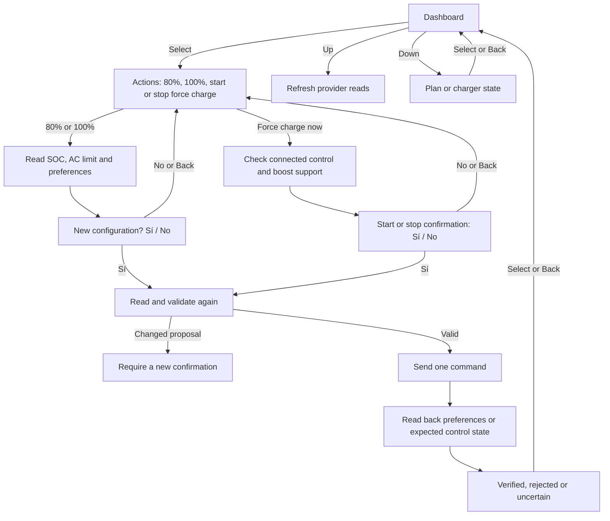

# Navigation and screens

Updated 13 November 2026. **octopus-kia** targets Pebble Time 2 / emery, 200×228,
with Spanish labels, a C watch UI and an ES5 phone companion. Credentials and API
calls remain on the phone.

## Dashboard and visual language

Black background, purple selected cards, cyan highlights, white primary text and
gray secondary text. Battery percentage is the largest value. Its heading uses
Pleos model, for example **EV6 · BATERÍA ACTUAL**, with Kia fallback. Separate
cards show the additional percentage and ready-by time. Show provider errors and
the Kia vehicle report timestamp below them.

Native 16×16 Octopus favicon sits beside the short “octopus” header; launcher and
Android configuration use the full **octopus-kia** name. Load the bitmap once per
window lifetime and release it on unload. The right strip maps physical buttons.
The phase appears on all views; see [PHASES.md](PHASES.md).
On every Sí/No confirmation, the middle-button icon is a **tick**: Select applies
the highlighted choice. Plan/result screens retain the back arrow because Select
returns to the dashboard. The tick covers 80%, 100%, boost start and boost stop.

A green clock / ON requires verified SMART dispatches, not just saved preferences.
Hide it during boost. Source freshness/error text is separate from the badge.
See [resource provenance](resources/README.md) for the supplied favicon.

## Navigation

| Screen | Content | Buttons |
| --- | --- | --- |
| Dashboard | Model/SOC, selected extra charge, ready time, phase, timestamp and source messages. | Up refresh; Select actions; Down plan; Back exit. |
| Actions | Three rows: 80%, 100%, and Forzar carga ahora or Detener carga while boosting. Target rows show calculated additions; boost requires a connected car. | Up/Down moves one row; Select prepares; Back dashboard. |
| Target confirmation | ¿Quieres enviar la nueva configuración? Reported SOC → target, exact addition, ready time, Sí/No. | No by default; Up Sí; Down No; Select activates; Back cancels. |
| Boost confirmation | ¿Estás seguro? Forzar carga ahora; Hasta el límite del coche; Fuera del plan horario; Sí/No. | Same default-No controls. |
| Stop confirmation | ¿Detener carga? Detener carga forzada; return to the timetable without changing preferences; Sí/No. | Same default-No controls. |
| Checking / sending | Progress text while the phone validates or submits. | Duplicate presses ignored; a sent request cannot be cancelled by leaving. |
| Result | Verified preferences, confirmed boost, rejection or uncertain outcome. | Select/Back dashboard. |
| Plan / state | Dated Madrid windows or phase-specific guidance. | Up/Down scroll; Select/Back dashboard. |

Saving preferences is allowed while disconnected. Starting immediate charging
requires connected readiness before and after Sí. Do not conflate the two paths.
While BOOSTING, the third row becomes **Detener carga**. The phone rechecks
active boost and cancellation support after Sí, sends CANCEL once and verifies
return to smart control. It never switches a pending stop into a start.

## Confirmation and data rules

No/Back never sends a command. Preparing/confirming reads the latest available
data. Changed target inputs or an expired proposal require confirmation again.
Cached parked-car SOC remains usable regardless of age, with its timestamp shown.
Exact additional charge, provider minimum/step and Kia AC-limit checks are in
[CONTROL.md](CONTROL.md); boost checks and read-back are in [BOOST.md](BOOST.md).

A failed refresh retains last known values with an error indicator. Values begin
as -- after companion restart until read. The watch's 45-second response timeout
shows uncertainty; late verified results can replace that result. Unknown writes
remain fenced across companion restart. A sending operation is not cancellable.

## Current visual evidence

| Capture | Scope |
| --- | --- |
| [EV6 dashboard](docs/screenshots/dashboard.png) | Model label and schedule badge, synthetic data. |
| [Launcher](docs/screenshots/launcher.png) | Renamed app entry. |
| [Actions](docs/screenshots/actions.png) | All three rows and boost selection. |
| [Default No](docs/screenshots/start-confirmation.png) | Immediate-charge confirmation. |
| [Active result](docs/screenshots/boost-active.png) | Synthetic BOOSTING read-back. |

[Stop menu](docs/screenshots/stop-menu.png),
[default No](docs/screenshots/stop-confirmation.png),
[stop result](docs/screenshots/stop-result.png) and
[restored dashboard](docs/screenshots/smart-control-restored.png) capture the complete
offline start/stop round-trip. These images do not prove physical-watch behavior. The
[selected gallery](docs/screenshots/index.html) and its manifest are maintained
under docs/screenshots; generated full catalogs belong in ignored artifacts/.

See [DEVELOPMENT.md](DEVELOPMENT.md) for tests/build/emulator instructions and
[STATUS.md](STATUS.md) for the built-versus-installed distinction. The physical watch was updated on 13 November; its new UI still needs user validation.
